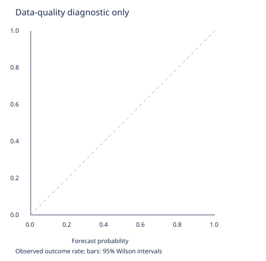

# PM-C1-v0.1 — first experiment

**Verdict: RETEST_WITH_BETTER_DATA**. Strict data status: **DATA_INVALID**.

## Hypothesis
A calibration transformation estimated only from past settled events improves probability scoring and produces positive expectancy after executable prices, costs and uncertainty.

## Data
Dataset SHA-256: `922f3a95ee7ea5d9062be00cf113e509a78827422112ff668765c26394e11040`. 0 market rows; 0 distinct event representatives (independence unproven); 0 pass timestamp integrity. Source: polymarket. Dates: None to None.

## Exact strategy rules
20 equal probability bins. Prior weight 20 centred on the input probability. Train only on labels available before the next chronological split. One lexicographically first market per event. Unknown event relationships share a conservative cluster. No thresholds tuned on this sample.

## Entry rules
Buy YES only when the lower empirical bin bound minus executable ask, actual per-position fees and slippage exceeds 2.00%; at least 20 observations in the training bin. Require verified metadata/quote availability, historical fees and depth. Hold to binary settlement.

## Position sizing
Normal position maximum loss 0.25%, absolute code ceiling 0.50%, correlated event cluster 1.00%, portfolio 2.00%. Fractional Kelly 0.10 can only reduce size. Default simulated bankroll $100. Venue minimum size, share step, cash and depth may cause a zero-size rejection.

## Costs
Fees must be verified for the historical trade time. Current schedules are not assumed historical. Slippage reserve $0.005/share is a proposed research stress input, not a measured fill estimate. No maker rebates, funding bonuses or assumed free fills.

## Sample size
Strict valid records: 0. Candle-only records cannot substantiate executable performance.

## Calibration
Descriptive inspection of raw pre-settlement observations follows. It is neither a valid backtest nor OOS forecasting evidence.
- n: 0
- brier: None
- log_loss: None
- ece: None
- sharpness: None
- auc: None



| Probability bucket | n | Mean quote | Outcome rate | 95% Wilson interval |
|---|---:|---:|---:|---|

## Gross results
No tradability claim. See the strict split results below; rejected data never produces trades. Drawdown requires a full marked quote stream for intratrade accuracy.

## Net results
No tradability claim. See the strict split results below; rejected data never produces trades. Drawdown requires a full marked quote stream for intratrade accuracy.

## Drawdown
No tradability claim. See the strict split results below; rejected data never produces trades. Drawdown requires a full marked quote stream for intratrade accuracy.

## Monte Carlo
{"paths":0,"status":"NOT_RUN_NO_TRADES"}. No survival evidence can be inferred when no valid trades exist.

## Train results
```json
{
  "market": {
    "n": 0,
    "brier": null,
    "log_loss": null,
    "ece": null,
    "sharpness": null,
    "auc": null
  },
  "calibrated": {
    "n": 0,
    "brier": null,
    "log_loss": null,
    "ece": null,
    "sharpness": null,
    "auc": null
  },
  "brier_improvement_ci": {
    "mean": null,
    "lower": null,
    "upper": null,
    "clusters": 0
  },
  "backtest": {
    "mode": "EXECUTION_REALISTIC_INPUTS_CONSERVATIVE_FILL",
    "initial_bankroll": 100.0,
    "ending_cash": 100.0,
    "trades": [],
    "trade_count": 0,
    "gross_pnl": 0,
    "net_pnl": 0,
    "net_ev_per_trade": null,
    "settlement_equity_drawdown": 0.0,
    "rejections": {},
    "limitation": "Settlement/cost-basis drawdown; intratrade marked equity requires a complete quote stream. Fill simulations are not live fills."
  }
}
```

## Validation results
```json
{
  "market": {
    "n": 0,
    "brier": null,
    "log_loss": null,
    "ece": null,
    "sharpness": null,
    "auc": null
  },
  "calibrated": {
    "n": 0,
    "brier": null,
    "log_loss": null,
    "ece": null,
    "sharpness": null,
    "auc": null
  },
  "brier_improvement_ci": {
    "mean": null,
    "lower": null,
    "upper": null,
    "clusters": 0
  },
  "backtest": {
    "mode": "EXECUTION_REALISTIC_INPUTS_CONSERVATIVE_FILL",
    "initial_bankroll": 100.0,
    "ending_cash": 100.0,
    "trades": [],
    "trade_count": 0,
    "gross_pnl": 0,
    "net_pnl": 0,
    "net_ev_per_trade": null,
    "settlement_equity_drawdown": 0.0,
    "rejections": {},
    "limitation": "Settlement/cost-basis drawdown; intratrade marked equity requires a complete quote stream. Fill simulations are not live fills."
  }
}
```

## OOS results
```json
{
  "n": 0,
  "status": "UNTOUCHED"
}
```

## Failure analysis
Unknown historical publication time and retrospective metadata fail the as-of gate. A closed market's final displayed price is never treated as a forecast or a resolution label.

## Robustness tests
Not evaluated until valid data exists. Planned: event-block bootstraps, chronological walk-forward, category/time stability, fixed parameter perturbations, and 10,000-path bankroll simulations. These are required work, not completed evidence.

## Known limitations
Recent validation sample is not a complete market universe. Candle bid/ask may be asynchronous and has no depth. Actual publication/revision times are absent. A Wilson bin interval is not an individual event posterior. Correlation with the XAUUSD system cannot be measured without matched timestamped returns.

## Verdict
**RETEST_WITH_BETTER_DATA**. Profitability and an income-capable bankroll remain unestablished.

## Reproducibility
Commit `a43d4a99d1b23d749b540fe046b5761a20e28118`; model `beta-bin-market-prior-v0.1`; seed 20261001. Exact config, source metadata, rejection list and machine results are in `PM_C1_POLYMARKET_v001.json`. TEST remains UNTOUCHED.
